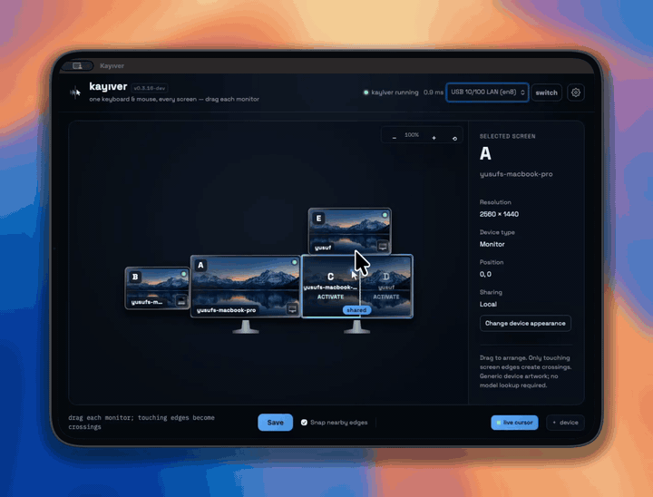
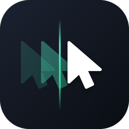

[](https://github.com/yusufani/kayiver/releases/download/v0.3.16-dev/kayiver-demo.mp4)

<p align="center"><a href="https://github.com/yusufani/kayiver/releases/download/v0.3.16-dev/kayiver-demo.mp4">▶ Watch the full demo (22 seconds)</a></p>

<p align="center"></p>

# Kayıver

[](https://github.com/sponsors/yusufani)
[](https://paypal.me/yusufani)
[](LICENSE)

**One keyboard & mouse, every screen.**

Kayıver is a lightweight, source-available software KVM. Slide your cursor off
the edge of one machine's screen and it appears on the next, exactly like
moving between two monitors of the same computer. Keyboard input follows the
cursor.

- **One movement engine** — ordered movement samples cross actual monitor
  edge segments; remaining distance continues on the destination, including
  an immediate reversal. Floating-point position is rounded only when applied
  to the operating system. Protocol 16 requires both desktops to run 0.3.2.
- **Recoverable control** — triple-tap `Esc` returns control to a visible local
  screen. Disconnects and failed cursor injection release held input and
  recover locally. Old-session and duplicate movement frames are rejected.
- **VPN-proof** — connections try a static address before mDNS discovery,
  so a corporate VPN that blocks multicast doesn't break anything.
- **Secure by default** — one-time PIN pairing (SPAKE2), then every session
  is end-to-end encrypted (Noise `NNpsk0`, ChaCha20-Poly1305).
- **Shared-monitor aware** — one panel cabled to both machines? Mark it in
  the editor; when you flip the panel's input, `kayiver monitor <machine>`
  (or Cmd/Ctrl+Alt+M, the menu-bar item, the editor, or the Android app)
  tells kayiver who the panel is showing: the hidden machine's cursor skips
  over its copy so it can never strand itself on a screen nobody can see,
  crossings through the panel resolve by real monitor geometry, and the
  ownership survives restarts.
- **Desktop input** — the source supplies accelerated desktop movement and
  the destination applies the calculated cursor position. Raw-input games,
  secure desktops and physical acceleration feel need platform acceptance
  checks; 0.3.2 does not claim universal game compatibility.
- **Real apps** — a menu-bar app with a native editor window on macOS
  (`packaging/macos/build-app.sh --install` → `Kayiver.app`), tray icon +
  embedded-icon exe on Windows, and an Android companion
  ([apps/android](apps/android)) for remote status + shared-monitor handoff.
- **Autostart** — `kayiver autostart enable` and it's just *there* after boot.

| Platform | Give input (host) | Receive input (client) |
|----------|:-:|:-:|
| macOS    | ✅ | ✅ |
| Windows 10/11 | ✅ | ✅ |
| Linux    | 🚧 planned | 🚧 planned |
| Android  | — | 🚧 planned (see [docs/PLATFORMS.md](docs/PLATFORMS.md)) |
| iOS/iPadOS | 🚧 controller only | ❌ OS restriction (see [docs/PLATFORMS.md](docs/PLATFORMS.md)) |

## Download

Get the current **[0.3.16-dev prerelease](https://github.com/yusufani/kayiver/releases/tag/v0.3.16-dev)**:

- **[macOS (Apple silicon) — DMG](https://github.com/yusufani/kayiver/releases/download/v0.3.16-dev/Kayiver-macos-arm64.dmg):** open the disk image and drag Kayıver into Applications. The app is self-signed, not notarized; macOS may require approval in **System Settings → Privacy & Security** on first launch.
- **[Windows 10/11 (x64) — EXE](https://github.com/yusufani/kayiver/releases/download/v0.3.16-dev/kayiver-windows-x64.exe):** download and run. If SmartScreen appears, choose **More info → Run anyway**.
- **[macOS ZIP alternative](https://github.com/yusufani/kayiver/releases/download/v0.3.16-dev/Kayiver-macos-arm64.zip)** · **[SHA-256 checksums](https://github.com/yusufani/kayiver/releases/download/v0.3.16-dev/SHA256SUMS)**

Upgrade both computers together and keep the previous binaries for rollback.
This build reduces idle CPU use and preserves responsive crossings after idle;
fast crossing and dragging were checked on the paired Mac and Windows machines.
Menu-based clipboard copies can take up to about 0.5 seconds to be detected.
See [testing](docs/TESTING.md) for the automated and physical acceptance checks.

Or build from source:

## Quick start

Build (Rust 1.85+):

```sh
cargo build --release          # -> target/release/kayiver
```

Cross-compile a Windows binary from macOS/Linux (no Rust needed on the
Windows box): install mingw-w64 (`brew install mingw-w64`), then

```sh
rustup target add x86_64-pc-windows-gnu
cargo build --release --target x86_64-pc-windows-gnu   # -> kayiver.exe
```

**1. Pair** (once). On the machine that has the keyboard/mouse:

```sh
kayiver pair
# shows a 6-digit PIN and this machine's IP
```

On the other machine:

```sh
kayiver join <host-ip>
# type the PIN
```

**2. Run** both sides:

```sh
kayiver run
```

**3. Arrange your screens** (drag & drop):

```sh
kayiver ui
```

opens the visual layout editor — a native window on macOS, browser app-window
elsewhere. Drag the machines to match your desk; touching edges become
crossings, and dropping one monitor onto another marks a physically shared
panel. Saving applies **live** to a running host, no restart needed. (Prefer
a file? `kayiver config-path` works too.)

**4. Make it permanent:**

```sh
kayiver autostart enable
```

Now push your cursor against the edge between the machines. That's it.

macOS will ask for **Accessibility** and **Input Monitoring** permissions on
first run (System Settings → Privacy & Security). `kayiver doctor` shows what's
missing.

## Layout

Pairing creates a default layout (new machine to the right of the host).
`kayiver ui` is the comfortable way to change it; under the hood it writes:

```toml
[[layout.links]]
from = "mac-studio"     # when mac-studio's cursor exits its...
edge = "right"          # ...right edge...
to = "win-desktop"      # ...it enters win-desktop (from the left)
```

Links are bidirectional; positions map proportionally between different
resolutions. Any edge (`left`/`right`/`top`/`bottom`) works, and you can
chain machines: `mac ⇄ win ⇄ tablet`.

## On a VPN / multicast-blocked network?

Pairing stores the host's address, and clients always try it before mDNS:

```toml
[[peers]]
name = "mac-studio"
addr = "10.8.0.3:24817"   # update if the host IP changes
```

Only TCP port **24817** (configurable) between the machines is required.

## Troubleshooting

| Symptom | Fix |
|---|---|
| Cursor won't cross | `kayiver doctor` on both sides: are they connected? Portal edges only arm when the peer is online. |
| Cursor stuck on remote machine | Triple-tap `Esc` — input snaps back to the host. |
| "CGEventTapCreate failed" on macOS | Grant Accessibility + Input Monitoring to your terminal (or the kayiver binary), then restart kayiver. |
| Not discovered over Wi-Fi | Multicast may be filtered; set `addr` on the client's peer entry (see above). |
| Occasional lag spikes | kayiver keeps the Wi-Fi radio awake by itself while (and shortly after) input flows — set `heartbeat = "always"` if the first crossing after a long idle still lags, `"off"` to disable. Ethernet remains the zero-jitter option. |
| Keys stuck after crossing | Shouldn't happen (both sides release held keys on every focus change) — file a bug with `RUST_LOG=debug` output. |
| Need logs from a background instance | Set `KAYIVER_LOGFILE=/path/to/kayiver.log` before launching; every event is written and flushed there. |

## The desk it's tested on

Every commit ships to a real desk and has to survive it before it lands on
`main`:

- **Host:** MacBook Pro (Apple silicon), 2560×1440 main screen — signed
  `Kayiver.app`, menu-bar UI.
- **Client:** Windows 11 desktop — tray exe, autostarted into the interactive
  console session by a scheduled task.
- **Shared panel:** one 2560×1440 monitor cabled to *both* machines;
  ownership flips with the monitor's input switch + Ctrl/Cmd+Alt+M.
- **Extra screen:** a Windows-only 1920×1080 sitting physically *above* the
  shared panel — reachable from the Mac straight up through the panel, by
  pure geometry.
- **Third device:** an Android tablet on the left edge via scrcpy (wireless,
  with an idle heartbeat that defeats Wi-Fi power saving).
- **Network:** ordinary Wi-Fi LAN, ~5 ms median RTT.

The same setup is on the project page: **[yusufani.github.io/kayiver](https://yusufani.github.io/kayiver/)**.

## Support

Kayıver is MIT-licensed and always will be. If it saved your desk from a
hardware KVM (or a second keyboard), consider fueling the next platform —
Linux is on the bench:

**[GitHub Sponsors](https://github.com/sponsors/yusufani)** ·
**[PayPal](https://paypal.me/yusufani)**

## Testing without hardware

`cargo test --features sim -p kayiver` runs the full engine — real router,
real Noise encryption, real TCP — on a **virtual two-machine desk** with
scriptable monitors, cursor, and injection. Every bug class from the real
desk has a regression scenario there. See [docs/TESTING.md](docs/TESTING.md).

## Documentation

- [docs/ARCHITECTURE.md](docs/ARCHITECTURE.md) — components, threads, the crossing state machine, latency design
- [docs/PRODUCT-DESIGN.md](docs/PRODUCT-DESIGN.md) — device visuals, unknown-hardware fallback, free placement and desktop notification contract
- [docs/TESTING.md](docs/TESTING.md) — the simulated two-machine test desk
- [docs/PROTOCOL.md](docs/PROTOCOL.md) — wire protocol specification
- [docs/SECURITY.md](docs/SECURITY.md) — threat model, pairing & session crypto
- [docs/PLATFORMS.md](docs/PLATFORMS.md) — per-OS implementation notes, Android/iOS plans, shared-monitor (DDC/CI) story
- [docs/ROADMAP.md](docs/ROADMAP.md) — what's next

## License

**Free for personal use.** Kayıver is licensed under the
[PolyForm Noncommercial License 1.0.0](LICENSE): individuals and other
noncommercial users can use it freely. **Companies and any commercial use
need a commercial license** — get in touch: **yusuf.ani8@gmail.com**.

Image clipboard sharing is supported between macOS and Windows in 0.3.14-dev
(protocol 17; update both devices together). Copied bitmap images are sent as
PNG in encrypted 32 KiB chunks, capped at 16 MiB compressed / 64 MiB RGBA.
A single copied PNG/JPEG/GIF/WebP/TIFF/BMP file is also read as an image;
other copied files use Quick Share. Transfer failures
appear as clipboard issues, independently of network connection status.
